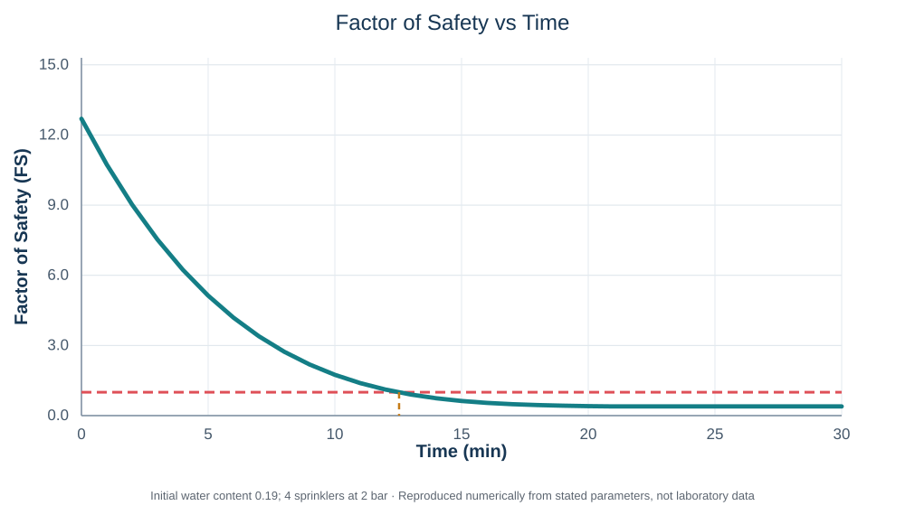
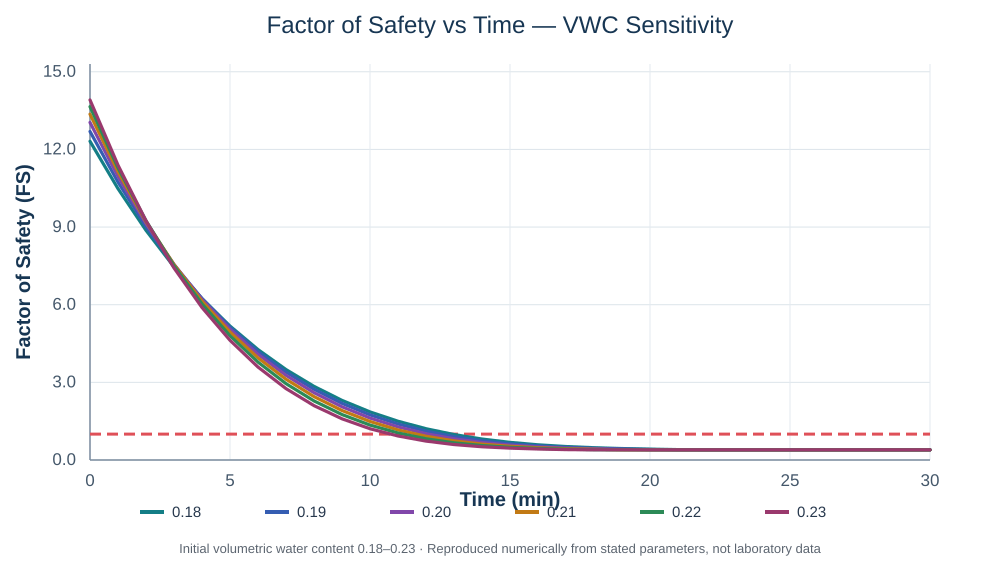

# SLIP Model Desktop v0.7

**A Windows desktop implementation of the Montrasio–Valentino (2008) model for rainfall-induced shallow-landslide stability.**

This repository contains an independent Python/PySide6 implementation of the original **SLIP** numerical formulation. The experimental sprinkler-footprint extension is **not included**. The existing simplified sprinkler pressure–discharge conversion remains available.



## Features

- Compute factor of safety **FS(t)** and the saturated-fraction variable **m(t)** from discrete rainfall increments.
- Enter representative soil properties and rectangular or trapezoidal **side-profile** geometry.
- Select direct rainfall intensity, the existing sprinkler-pressure calculation, or incremental-rainfall CSV input.
- Choose manually supplied drainage coefficient **K_T** or the optional **K/L** approximation.
- Run one-at-a-time sensitivity analysis, including a numerical summary of the first sampled **FS ≤ 1** and linearly interpolated crossing.
- Export numerical results as CSV and graphs as PNG.

## Download and install on Windows

**For non-programmers:** obtain the tested installer `SLIP_Model_Setup_v0_7.exe` from the [GitHub Releases page](https://github.com/amirshokri17/slip-model-desktop/releases) **when a release asset has been published**. The source files alone do not constitute the installer.

Once installed, the application does not require Python. The installer is currently unsigned, so Windows may report an unknown publisher. Confirm its source and checksum; do not disable antivirus or managed-device security rules.

## Run from source

The Windows build script requires **64-bit Python 3.15**. The application dependencies are pinned in `requirements.txt`. Python compatibility beyond the tested build environment is not guaranteed.

```powershell
py -3.15 -m venv .venv
.\.venv\Scripts\python.exe -m pip install -r requirements.txt
.\.venv\Scripts\python.exe main.py
.\.venv\Scripts\python.exe -m unittest discover -s . -p "test_*.py" -v
```

On Windows, build from a short path such as `C:\SLIPBuild` to avoid long file-path errors when installing the Qt wheels. To generate the installer, install [Inno Setup 6](https://jrsoftware.org/isinfo.php) and run `BUILD_WINDOWS_INSTALLER.bat`. See [build instructions](HOW_TO_BUILD_AND_DISTRIBUTE.txt).

## Reproducible numerical example



A documented 30-minute numerical run uses a 0.15 m representative soil layer, 35.2° slope, initial volumetric water content 0.19, and **four sprinklers at 2 bar**, converted by the application's **uniform rainfall** approximation to **110.025 mm/h** over 0.96 m².

| Numerical output | Value |
|---|---:|
| Initial FS | 12.6923 |
| FS at 12 min | 1.1138 |
| First sampled FS ≤ 1 | 13 min |
| Graphically interpolated FS = 1 | 12.53 min |
| Minimum *reported* FS | 0.3931 (after saturation-limit capping) |

The numerical model flags **m_raw > 1** from a later point in the run. Values computed with **m capped at 1** must not be interpreted as validated post-saturation predictions. Varying initial water content between 0.18 and 0.23 changes the graphical crossing from about 12.93 to 10.74 minutes in this scenario.

See [complete inputs, results and experimental-context notes](docs/NUMERICAL_EXAMPLE.md). These plots are **reproductions from the documented model parameters**, not experimental sensor measurements.

## Original scientific reference and attribution

Montrasio, L. and Valentino, R. (2008). *A model for triggering mechanisms of shallow landslides*. **Natural Hazards and Earth System Sciences**, 8, 1149–1159. [https://doi.org/10.5194/nhess-8-1149-2008](https://doi.org/10.5194/nhess-8-1149-2008).

**The original mathematical model belongs to its authors.** This repository is an independent software implementation; it is not an official product or an endorsement by the paper's authors or Politecnico di Milano. Software citation metadata are in [CITATION.cff](CITATION.cff).

## Scientific scope and limitations

The SLIP implementation represents a **homogeneous infinite slope** with an empirical apparent-cohesion relation. Geometry supplies volume and assumed rainfall area; it is **not** a 2D or 3D stress, infiltration or landslide-propagation solver. The `K_T = K/L` option is a teaching/implementation approximation, not a universal hydraulic identity. The original sprinkler option converts calibrated nozzle flow to **uniform rainfall over the selected exposed surface**; it does not calculate spray interception, wall return, runoff or nozzle overlap.

The saturated-fraction upper limit is `m = 1`. The engine preserves uncapped `m_raw`, caps `m` in stability calculations and warns upon exceedance; beyond this point the hydrologic assumptions are exceeded. Failure time displayed between samples is **linear graphical interpolation** and not an analytically solved triggering time. Numerical regression tests and installing on a second PC do not establish experimental validation.

The example refers to experimental observations only as **context**. No laboratory sensor records are distributed here, and no matched calibration or predictive-accuracy claim is made. Use for research and teaching; do not treat output as a certified geotechnical safety assessment.

## CSV input

The rainfall CSV format has the exact headers `time_s,depth_mm` and contains **incremental**, noncumulative rainfall depths in millimetres at their event-end timestamps. See [reference_rainfall.csv](reference_rainfall.csv).

## Tests, licensing and distribution

Regression tests are in `test_desktop.py` and `test_geometry.py`; a [Windows CI workflow](.github/workflows/tests.yml) runs them when GitHub Actions is available. The build process and Qt/PySide6 licensing notes are documented in [THIRD_PARTY_NOTICES.txt](THIRD_PARTY_NOTICES.txt).

**License:** The original SLIP Model Desktop application code and documentation authored for this project are released under the [MIT License](LICENSE), Copyright (c) 2026 Amir Shokri. You may use, modify and redistribute the MIT-licensed portions provided you retain the copyright and permission notice. **Third-party software (including PySide6/Qt) remains under its own licenses**; see [THIRD_PARTY_NOTICES.txt](THIRD_PARTY_NOTICES.txt). The MIT license does not grant rights over the original Montrasio–Valentino publication or laboratory datasets.
