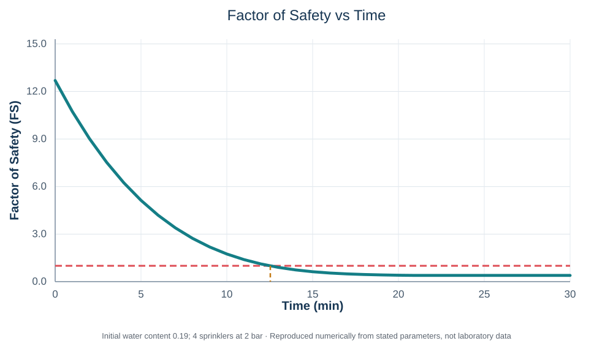
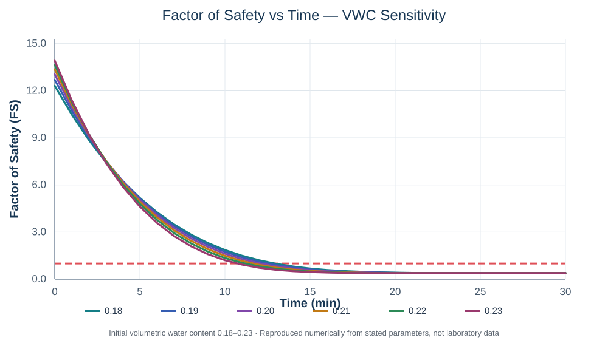

# Reproducible numerical example — SLIP Desktop v0.7

This is an **illustrative numerical scenario**, not a calibrated reconstruction of any particular laboratory test. The included figures are generated from the numerical equations and listed inputs, **not from sensor traces**.

## Inputs

| Parameter | Value | Units / interpretation |
|---|---:|---|
| Soil geometry | Trapezoidal | side profile, not plan-view trapezoid |
| Soil thickness H | 0.15 | m, normal to inclined platform |
| Platform slope β | 35.2 | degrees |
| Drainage length L | 1.82 | m, optional K/L approximation |
| Soil width W | 0.80 | m |
| Upper side-profile base Lu | 1.20 | m |
| Lower side-profile base Ll | 1.82 | m |
| Porosity n | 0.44 | – |
| Specific gravity Gs | 2.65 | – |
| Friction angle φ′ | 30 | degrees, assumed for example |
| Effective cohesion c′ | 0 | kPa |
| Initial volumetric water content θ | 0.19 | m³/m³ |
| Water unit weight γw | 9.81 | kN/m³ |
| Apparent-cohesion coefficient A | 40 | kPa |
| λ | 0.4 | – |
| α | 3.4 | – |
| Hydraulic conductivity K | 1.5 × 10⁻⁵ | m/s, not the laboratory's independently measured saturated K |
| Drainage mode | Derived K/L | K_T = 8.241758 × 10⁻⁶ s⁻¹ |
| Rainfall source | Original sprinkler calculated | simplified uniform-area method, **not** spray geometry |
| Active sprinklers | 4 | – |
| Water pressure | 2 | bar |
| Rainfall duration | 30 | min |
| Rainfall increment | 1 | min, applied at each increment's end |
| Simulation duration | 30 | min |
| FS evaluation step | 1 | min |

The exposed reference rainfall area is **Lu × W = 0.96 m²**. With the application's calibration `Q(P) = -0.0333P² + 0.23P + 0.1133` (L/min per nozzle), `Q(2 bar) = 0.4401 L/min`, and the resulting **uniform assumed rainfall intensity is 110.025 mm/h**. This does not account for water intercepted outside the soil or for surface runoff.

## Model outputs

| Time (min) | Factor of safety FS | Interpretation |
|---:|---:|---|
| 0 | 12.6923 | Initial computed condition |
| 5 | 5.1306 | Still above FS = 1 |
| 10 | 1.7448 | Still above FS = 1 |
| 11 | 1.3911 | Still above FS = 1 |
| 12 | 1.1138 | Still above FS = 1 |
| 13 | 0.9010 | First sampled FS ≤ 1 |
| 21 | 0.3931 | Saturation limit exceeded; capped calculation |
| 30 | 0.3931 | Saturation limit exceeded; capped calculation |

The threshold is crossed **between the 12- and 13-minute sampled results**. Straight-line interpolation yields about **12.5347 min**, and is a graphical estimate only, not a continuous-time solution of the original discrete-rainfall formula.

The engine tracks `m_raw` independently from the capped `m`. At minute 21, `m_raw ≈ 1.0153` and the model flags an exceeded physical limit. The reported `FS = 0.3931` plateau is therefore **not a physically validated post-saturation response**.

## Parameter sensitivity

For this same run, changing only the initial water-content input produces:

| Initial θ | Initial FS | First sampled FS ≤ 1 (min) | Interpolated time (min) |
|---:|---:|---:|---:|
| 0.18 | 12.3139 | 13 | 12.9261 |
| 0.19 | 12.6923 | 13 | 12.5347 |
| 0.20 | 13.0418 | 13 | 12.0796 |
| 0.21 | 13.3619 | 12 | 11.6615 |
| 0.22 | 13.6518 | 12 | 11.1966 |
| 0.23 | 13.9110 | 11 | 10.7417 |

This is a **one-variable numerical sensitivity study**, not a measured hydrological time series.

## Experimental context — separate observation, not validation

In a 5 November 2026 Politecnico di Milano rainfall-flume experiment, the observational notes indicate a first small toe crack at approximately **5 minutes**, further cracks around **8–10 minutes**, and a **local collapse around 11 minutes**. Those are distinct, spatially localized observed events.

The numerical run above was **not proven to use an identical measured rainfall field, measured shear-strength parameters, matched hydraulic conductivity, or synchronized initial conditions**. The model's representative infinite-slope `FS = 1` threshold is not necessarily the first crack or a local collapse. Therefore, any comparison of approximately 11 min observed local collapse with approximately 12.53 min calculated threshold **is illustrative only** and is not a quantified prediction error or a validation claim.

Raw laboratory data are intentionally not included in this public repository.

## How to reproduce

Run the installed Windows application or `main.py`, enter the table values, choose **Sprinkler calculated** (the original method), and select **Run SLIP Analysis**. The graphical output can be exported to PNG, and the numerical table to CSV. Under **Analysis → Sensitivity Analysis**, choose **Volumetric water content** and values `0.18, 0.19, 0.20, 0.21, 0.22, 0.23`.
